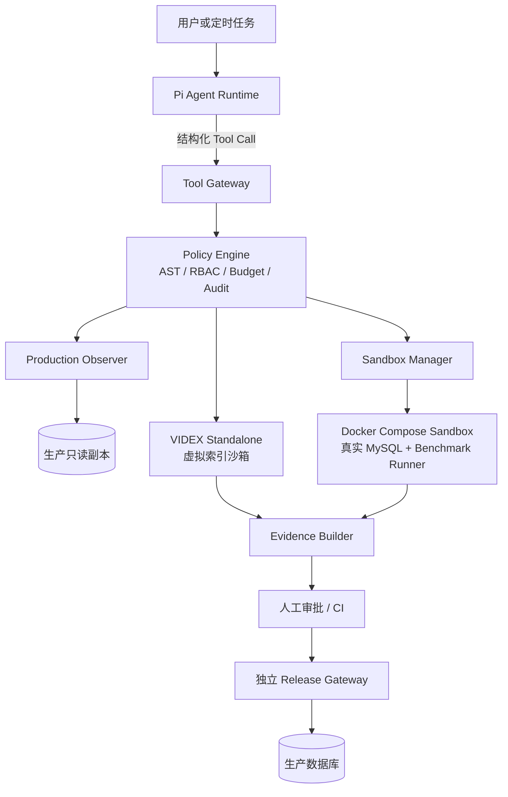
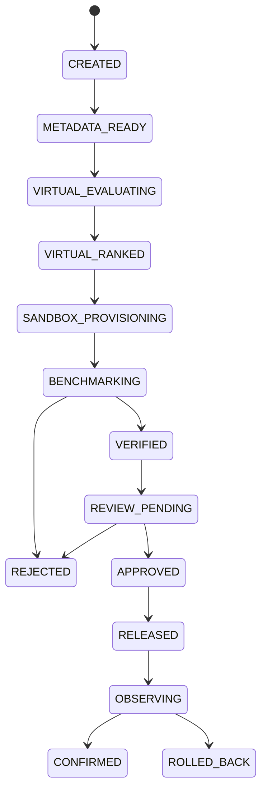

# SQL Agent

基于 [Pi](https://github.com/badlogic/pi-mono)、[VIDEX](https://github.com/bytedance/videx) 与 Docker Compose 构建的慢 SQL 分析与索引优化 Agent。

SQL Agent 将大模型限制在“分析与提出候选方案”的范围内：生产环境只读采集，VIDEX 负责低成本虚拟索引筛选，隔离的 MySQL 沙箱负责结果等价性与真实性能验证，最终输出带完整证据的优化建议。

> 项目状态：设计与 MVP 阶段。当前方案优先支持 MySQL 8.0，生产 DDL 自动执行不在 MVP 范围内。

## 为什么做这个项目

传统慢 SQL 优化通常需要人工完成一整套链路：发现慢查询、理解执行计划、设计索引、构造验证环境、运行基准测试、评估回归风险，再提交生产变更。

LLM 可以提高其中的分析效率，但不能直接获得生产数据库写权限。SQL Agent 的核心目标是把 Agent 的推理能力与数据库执行权限分离，让每一项建议都经过可复现、可审计、可回滚的验证流程。

项目遵循以下原则：

- Agent 不持有生产数据库凭据。
- 生产环境只用于受控、只读的信息采集。
- Pi 不获得通用 `execute_sql`、Docker Socket 或生产 DDL 工具。
- VIDEX 只做候选召回和计划成本初筛，不把估算成本等同于真实延迟。
- 所有候选索引必须进入真实沙箱验证。
- 没有结果等价性证据的 SQL 改写不得进入发布流程。
- MVP 只输出 Evidence Package，生产发布由独立审批与发布系统完成。

## 总体架构



系统分为五层：

1. **Pi Agent Runtime**：负责推理、调用工具、候选索引生成和报告解释。
2. **Tool Gateway**：管理身份、权限、SQL 策略、资源预算、任务状态和审计。
3. **VIDEX Virtual Sandbox**：使用 DDL 与统计信息进行虚拟索引 What-if 分析。
4. **Docker Compose Sandbox**：在隔离数据集上创建真实索引、执行 SQL 和运行工作负载测试。
5. **Evidence & Release**：生成证据包，由独立审批和发布链路决定是否应用到生产环境。

## 优化工作流



完整链路：

1. 从 `performance_schema`、慢日志或外部观测平台导入 SQL Digest。
2. 对 SQL 做指纹化和参数分桶，提取调用量、总耗时和业务等级。
3. 通过只读采集器生成 Schema、索引、统计信息和优化器参数快照。
4. Pi 基于执行计划、过滤条件、连接关系和排序方式生成候选索引。
5. VIDEX 对候选索引及索引组合进行计划成本评估。
6. 去除冗余索引和回归候选，仅保留 Top-K 方案。
7. Sandbox Manager 创建一次性 Docker Compose 环境并恢复脱敏数据。
8. 在真实 MySQL 中创建候选索引，运行正确性和性能测试。
9. 生成 Evidence Package 并提交人工审批。
10. 独立发布系统执行生产变更并持续观察实际效果。

## Pi Tool 设计

Pi 通过项目级 TypeScript Custom Tools 调用 Tool Gateway。所有工具使用资源 ID，不向模型暴露 DSN、数据库密码或 Docker 参数。

### 生产观察工具

```text
workload.list_slow_queries
workload.get_query
catalog.create_snapshot
catalog.get_schema
catalog.get_statistics
plan.get_production_explain
```

生产观察工具必须满足：

- 只能连接只读副本或受控诊断接口。
- 优先接收 `query_id`，不执行 Agent 任意生成的 SQL。
- 禁止 `EXPLAIN ANALYZE`。
- 设置查询、锁、连接和返回数据预算。
- 输出 SQL 模板、计划和统计信息时移除敏感 literal。

### VIDEX 工具

```text
videx.create_workspace
videx.load_metadata_snapshot
videx.get_baseline_plan
videx.evaluate_index
videx.evaluate_index_set
videx.drop_virtual_index
videx.destroy_workspace
```

示例：

```json
{
  "tool": "videx.evaluate_index_set",
  "workspace_id": "vw_01",
  "query_ids": ["q_1001", "q_1002"],
  "indexes": [
    {
      "table": "orders",
      "columns": ["customer_id", "created_at"],
      "type": "BTREE"
    }
  ]
}
```

### 真实沙箱工具

```text
sandbox.create
sandbox.restore_dataset
sandbox.apply_index
sandbox.run_query
sandbox.run_workload
sandbox.compare_results
sandbox.collect_metrics
sandbox.destroy
```

Pi 只提交实验目标和资源预算：

```json
{
  "tool": "sandbox.run_workload",
  "sandbox_id": "sb_01",
  "candidate_id": "idx_17",
  "budget": {
    "timeout_seconds": 30,
    "runs": 10,
    "max_cpu": 2,
    "max_memory_mb": 4096,
    "max_temp_mb": 2048
  }
}
```

### 方案工具

```text
proposal.create
proposal.get_evidence
proposal.submit_for_review
```

MVP 不提供 `production.execute_ddl`、`production.create_index` 或 `production.change_config`。

## VIDEX 虚拟索引沙箱

项目使用 VIDEX Standalone Mode，不在生产 MySQL 中安装 VIDEX Plugin。

采集器为每次分析生成不可变快照：

```text
snapshot/
├── schema.sql
├── indexes.json
├── statistics.json
├── histograms.json
├── server-variables.json
├── workload.jsonl
└── manifest.json
```

`manifest.json` 至少保存：

- 数据库版本和关键优化器参数。
- Schema 版本及统计信息采集时间。
- SQL Digest 与参数桶。
- 匿名数据源标识。
- 每个快照文件的 SHA-256。
- 脱敏策略版本。

VIDEX 负责评估候选索引对访问路径、连接顺序和计划成本的影响。候选集合采用有界搜索，避免 Agent 无限生成索引：

1. 从等值过滤、范围过滤、Join、Order By 和 Group By 字段产生候选列。
2. 组合最多 2～4 列的复合索引。
3. 去除已有索引前缀和明显冗余方案。
4. 对单索引和索引组合进行 VIDEX 评估。
5. 仅将排名靠前的方案送入真实沙箱。

工作负载级评分可表示为：

```text
Score(indexes) =
  Σ query_weight × log(baseline_cost / candidate_cost)
  - storage_penalty
  - write_amplification_penalty
  - redundancy_penalty
```

VIDEX 当前不支持函数索引、Full-Text 和 Spatial Index，这些候选应在能力检测阶段拒绝或路由到其他验证器。

## Docker Compose 真实沙箱

每个实验使用独立的 Compose Project、内部网络和一次性数据卷。

```yaml
services:
  mysql:
    image: registry.local/mysql-sandbox@sha256:REPLACE_ME
    cap_drop: ["ALL"]
    security_opt:
      - no-new-privileges:true
    mem_limit: 4g
    cpus: 2
    pids_limit: 256
    networks: [sandbox]
    volumes:
      - db-data:/var/lib/mysql
    tmpfs:
      - /tmp:size=512m
    healthcheck:
      test: ["CMD", "mysqladmin", "ping", "-h", "127.0.0.1"]

  loader:
    image: registry.local/snapshot-loader@sha256:REPLACE_ME
    read_only: true
    cap_drop: ["ALL"]
    networks: [sandbox]
    depends_on:
      mysql:
        condition: service_healthy

  benchmark:
    image: registry.local/sql-benchmark@sha256:REPLACE_ME
    read_only: true
    cap_drop: ["ALL"]
    mem_limit: 1g
    cpus: 1
    networks: [sandbox]
    volumes:
      - results:/results

networks:
  sandbox:
    internal: true

volumes:
  db-data:
  results:
```

隔离要求：

- MySQL 不映射宿主机端口。
- 沙箱网络禁止访问公网和生产数据库。
- 不使用宿主机 bind mount。
- Pi 和 Tool Gateway 不挂载 Docker Socket。
- 只有 Sandbox Manager 可以创建和销毁 Compose Project。
- 镜像必须固定 digest，生成 SBOM 并进行漏洞扫描。
- 每个任务使用一次性数据库身份和加密临时卷。
- 到达 TTL、超时或预算上限后强制销毁容器和数据卷。

Docker Compose 适用于内部单租户 MVP。如果未来允许多租户或执行 UDF、脚本等不可信代码，应升级为 gVisor、Kata Containers 或 Firecracker VM。

## 数据集等级

| 等级 | 数据来源 | 成本 | 可信度 |
| --- | --- | ---: | ---: |
| L1 | 合成数据 | 低 | 低 |
| L2 | 保持 NDV、偏斜与关联关系的脱敏采样 | 中 | 中 |
| L3 | 加密的生产快照克隆 | 高 | 高 |

MVP 默认采用 L2，并尽可能保留：

- 主外键关系。
- 热点值和长尾分布。
- NULL 比例与重复率。
- 时间字段的周期性和倾斜。
- 字段长度及大对象大小分布。

进入自动发布阶段的建议必须通过 L3 或等价的生产影子流量验证。

## 正确性与性能验证

### 正确性

- 比较行数、NULL、重复行、DECIMAL 和时间字段。
- 无 `ORDER BY` 时按多重集合比较，不依赖结果顺序。
- 使用排序后的分块 Hash，避免将大结果集全部加载到内存。
- 覆盖典型、高选择性和低选择性参数。
- SQL 改写需要在多个数据快照或边界数据集上验证。

### 性能

采集以下指标：

- p50、p95、p99 延迟。
- 执行计划及计划变化。
- examined rows。
- 临时表和临时磁盘使用量。
- Buffer Pool 指标。
- CPU 和 IO 消耗。
- 索引大小及构建时间。
- INSERT/UPDATE 写入退化。
- 同一工作负载中其他 SQL 的计划回归。

建议的默认准入条件：

```text
目标 SQL p95 改善 >= 20%
工作负载加权耗时改善 >= 10%
关键 SQL 最大退化 <= 5%
结果 Hash 完全一致
索引空间不超过任务预算
写入吞吐退化 <= 5%
```

系统还应持续计算 VIDEX 预测与真实 MySQL 结果的偏差。偏差过大时，需要检查统计信息新鲜度、数据库版本、数据分布和优化器参数是否一致。

## 安全模型

安全设计假设模型输出、数据库元数据和 SQL 注释均可能包含不可信内容。

- Pi 不持有 DSN、云凭据或 Docker 权限。
- 所有 SQL 必须通过 AST 解析；解析失败即拒绝。
- 生产侧仅允许单条只读语句和固定函数白名单。
- 禁止多语句、DDL、DML、`CALL`、`DO`、`COPY`、`SET ROLE`、写入型 CTE、锁定读、文件和网络函数。
- 数据库账号和只读事务是最终权限边界，提示词和正则不是安全边界。
- 设置 statement、lock、connection、row、byte、CPU、内存和临时文件预算。
- 模型只接收归一化 SQL、Schema、执行计划和聚合统计，不接收原始业务数据。
- 所有工具调用保存 `job_id`、`tool_call_id`、输入 Hash、策略版本和结果摘要。

## Evidence Package

通过验证的候选方案输出结构化证据：

```json
{
  "query_digest": "abc123",
  "recommendation": {
    "table": "orders",
    "columns": ["customer_id", "created_at"],
    "ddl": "CREATE INDEX idx_orders_customer_created ON orders(customer_id, created_at)"
  },
  "videx": {
    "cost_reduction": 0.87,
    "plan_changed": true
  },
  "sandbox": {
    "baseline_p95_ms": 823,
    "candidate_p95_ms": 91,
    "improvement": 0.889,
    "result_equivalent": true,
    "runs": 20
  },
  "impact": {
    "index_size_mb": 1830,
    "build_time_seconds": 418,
    "write_regression": 0.031
  },
  "risk": "medium",
  "rollback": "DROP INDEX idx_orders_customer_created ON orders",
  "snapshot_hash": "...",
  "agent_version": "...",
  "policy_version": "..."
}
```

## 建议的仓库结构

```text
sql-agent/
├── apps/
│   ├── pi-runtime/
│   ├── tool-gateway/
│   ├── sandbox-manager/
│   └── release-gateway/
├── pi/
│   ├── tools/
│   │   ├── workload/
│   │   ├── catalog/
│   │   ├── videx/
│   │   ├── sandbox/
│   │   └── proposal/
│   ├── hooks/
│   │   └── security-gate.ts
│   └── skills/
│       └── sql-optimizer/
├── services/
│   ├── metadata-collector/
│   ├── sql-policy-engine/
│   ├── result-validator/
│   └── benchmark-runner/
├── sandbox/
│   ├── videx/
│   ├── mysql/
│   └── compose/
├── schemas/
│   ├── tool-contracts/
│   └── evidence/
└── deploy/
    ├── local/
    └── kubernetes/
```

## 核心数据模型

```text
analysis_job
query_fingerprint
query_parameter_bucket
metadata_snapshot
candidate_index
videx_evaluation
sandbox_instance
benchmark_run
result_equivalence
evidence_bundle
approval_record
production_outcome
```

所有实验使用 `job_id + tool_call_id + snapshot_hash` 关联，保证一次 Agent 决策可以被完整复现。

## Roadmap

### Phase 0：项目骨架

- [ ] 嵌入 Pi Runtime。
- [ ] 定义 TypeBox Tool Schemas。
- [ ] 实现 Tool Gateway、任务状态机和审计日志。
- [ ] 禁用 Pi 的通用 Bash 与生产执行能力。

### Phase 1：VIDEX 单 SQL 优化

- [ ] MySQL Schema 与统计信息采集。
- [ ] VIDEX Standalone 部署。
- [ ] 单索引、复合索引候选生成。
- [ ] 虚拟计划成本对比。

### Phase 2：真实沙箱

- [ ] Sandbox Manager。
- [ ] 按任务创建和销毁 Compose Project。
- [ ] 脱敏数据装载。
- [ ] 查询基准测试与结果 Hash 验证。

### Phase 3：工作负载优化

- [ ] SQL Digest 权重模型。
- [ ] 索引组合搜索。
- [ ] 写入放大和冗余索引惩罚。
- [ ] 工作负载回归检测。

### Phase 4：生产闭环

- [ ] Evidence Review UI。
- [ ] 独立 Release Gateway。
- [ ] Invisible Index 灰度策略。
- [ ] 上线后观测、自动降级和回滚建议。

## 自治等级

| 等级 | 能力 |
| --- | --- |
| L0 | 只观察和解释 |
| L1 | 自动完成 VIDEX 验证 |
| L2 | 自动完成真实沙箱测试 |
| L3 | 自动生成并提交审批单 |
| L4 | 人工批准后由独立发布服务执行 |
| L5 | 仅对多次验证成功的低风险动作自动发布 |

MVP 目标为 L2，不包含生产自动执行。

## 参考项目

- [Pi](https://github.com/badlogic/pi-mono)：轻量、可扩展的 Agent Runtime，支持 TypeScript Custom Tools、Hooks、RPC 与 SDK 嵌入。
- [VIDEX](https://github.com/bytedance/videx)：字节跳动开源的 MySQL/MariaDB 虚拟索引和 What-if 分析引擎。
- [VIDEX: A Disaggregated and Extensible Virtual Index for the Cloud and AI Era](https://www.vldb.org/pvldb/vol18/p5231-zhang.pdf)：VIDEX 架构与生产实践论文。

## License

尚未确定。正式开放使用前请补充许可证文件。
