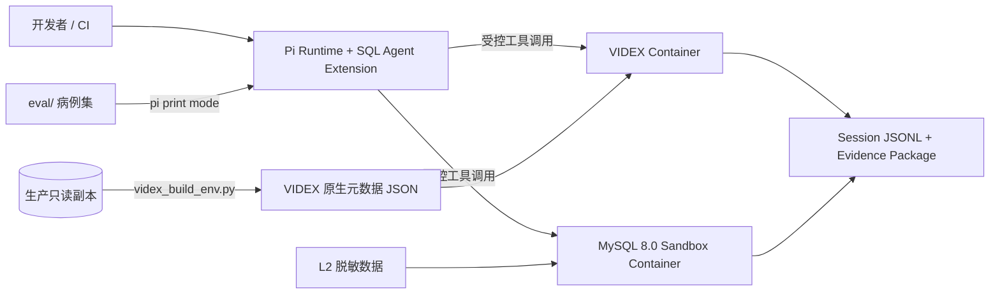
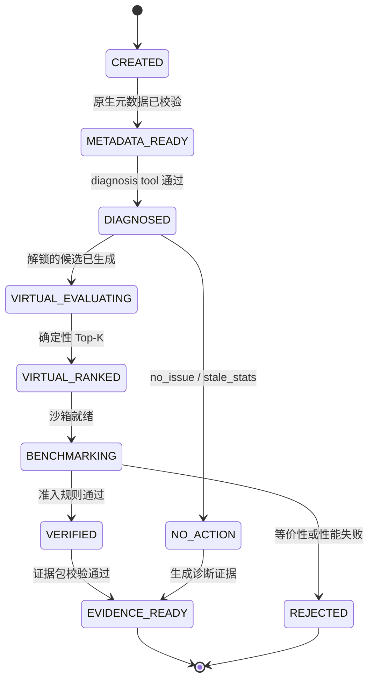
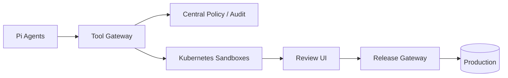

# SQL Agent

基于 [Pi](https://github.com/badlogic/pi-mono)、[VIDEX](https://github.com/bytedance/videx) 和 Docker Compose 构建的慢 SQL 诊断与优化 Agent。

SQL Agent 先判断慢 SQL 的病因，再生成与病因匹配的索引或 SQL 改写候选。VIDEX 用于低成本的 What-if 初筛，隔离的 MySQL 容器负责结果等价性与真实性能验证，最终产出可复现的 Evidence Package。

> 项目状态：方案设计 / MVP。首版只支持 MySQL 8.0，不执行生产 DDL。

## 设计原则

- 先诊断，后生成候选；`no_issue` 也是合法结论。
- LLM 只负责假设生成、病因诊断和结果解释。
- Top-K 筛选、候选准入、预算检查和状态转移全部由确定性代码执行。
- 生产环境只做受控的只读采集，Agent 不持有生产写权限。
- VIDEX 只负责候选召回和计划初筛，估算成本不等于真实延迟。
- 索引和 SQL 改写必须经过真实 MySQL 的正确性与性能验证。
- 每个结论都应能从 session JSONL、元数据快照和 benchmark 结果复现。

## MVP Scope

MVP 只包含以下四个可交付物：

1. **Pi extension**：提供诊断、VIDEX、MySQL 沙箱和报告工具；policy 检查直接内嵌在 tool 实现及 Pi `tool_call` hook 中。
2. **一个 VIDEX 容器**：加载生产只读副本生成的原生元数据 JSON，完成虚拟索引和任意 SQL 的虚拟 `EXPLAIN`。
3. **一个 MySQL 沙箱容器**：恢复 L2 脱敏数据，在同一实例内完成候选应用、结果校验和 benchmark。
4. **评估集**：覆盖缺索引、需要改写和无需优化三类病例，并可通过 Pi print mode 批量回放。

MVP 明确不包含：独立 Tool Gateway、独立 Policy Service、Sandbox Manager 服务、Release Gateway、Review UI、Kubernetes 部署、生产自动 DDL、多租户隔离和 LLM 自主发布。这些能力统一放在 [Future Architecture](#future-architecture)，不进入 MVP 的前三个 Phase。

## MVP 架构



Pi extension 在宿主机进程中运行，Compose 只启动 `videx` 和一个 `mysql` 容器。数据装载、benchmark 编排、结果比较和审计写入由 extension 中的确定性代码完成，不拆成独立服务。

## 职责与确定性边界

| 环节 | LLM | 确定性代码 |
| --- | --- | --- |
| 读取证据 | 解释计划与统计信息 | 裁剪、脱敏并校验 Tool Output Contract |
| 诊断 | 选择病因并陈述证据 | 校验枚举、证据完整性并写入状态机 |
| 生成候选 | 提出索引或 SQL 改写假设 | 按病因解锁候选类型、去重和限制数量 |
| VIDEX 初筛 | 解释计划变化 | 计算评分、过滤硬约束并选 Top-K |
| 真实验证 | 解释成功或失败原因 | 执行、结果比对、benchmark 和准入判定 |
| 状态推进 | 无权直接改变状态 | 根据工具返回值执行合法状态转移 |

LLM 输出不能直接将任务推进到下一状态。每次转移都必须由 tool 成功结果及确定性 guard 触发；session JSONL 记录输入、输出、状态和拒绝原因。

## 状态机



`DIAGNOSED` 是强制门禁：未成功调用 `proposal_report_diagnosis`，任何候选评估工具都不可用。

### 病因与候选解锁规则

`proposal_report_diagnosis` 使用枚举参数强制 Agent 先提交病因和证据：

```json
{
  "tool": "proposal_report_diagnosis",
  "arguments": {
    "query_id": "q_1001",
    "cause": "missing_index",
    "evidence": [
      "orders access_type=ALL, rows=1820341, filtered=0.8",
      "WHERE customer_id=? AND created_at>=? 未被现有索引覆盖"
    ]
  }
}
```

`cause` 只允许：

```text
missing_index | join_order | needs_rewrite | stale_stats | no_issue
```

确定性代码按下表解锁后续操作：

| 病因 | 解锁的候选 | 行为 |
| --- | --- | --- |
| `missing_index` | 索引候选 | 允许虚拟索引评估，再取 Top-K 进入 MySQL |
| `join_order` | 能改变访问路径的索引候选、等价 SQL 改写 | 必须用虚拟计划验证连接顺序变化 |
| `needs_rewrite` | 等价 SQL 改写 | 使用 `videx_explain_query` 初筛，禁止无依据地追加索引 |
| `stale_stats` | 无 | 输出刷新统计信息建议并停止，不在 MVP 中执行生产变更 |
| `no_issue` | 无 | 进入对照结论，不生成优化建议 |

如果后续证据支持另一病因，必须重新提交诊断并保留原诊断记录，不能绕过门禁扩展候选类型。

## Pi Extension 与 Tools

工具名称只使用字母、数字和下划线，以兼容 OpenAI function name 约束；不使用 `workload.list_slow_queries` 这类带点名称。

### 只读观察工具

```text
workload_list_slow_queries
workload_get_query
catalog_create_snapshot
catalog_get_schema
catalog_get_statistics
plan_get_production_explain
```

约束：

- 只连接生产只读副本或受控诊断接口。
- VIDEX 所需统计信息从生产只读副本采集，不从 L2 脱敏采样库推导。
- 优先接收 `query_id`，不在生产环境执行模型任意生成的 SQL。
- 禁止生产侧 `EXPLAIN ANALYZE`，并设置查询、锁、连接、行数与返回字节预算。
- SQL literal 必须脱敏；返回 schema 时只包含当前 SQL 涉及的表。

### 诊断与方案工具

```text
proposal_report_diagnosis
proposal_get_evidence
proposal_finalize
```

### VIDEX 工具

```text
videx_create_workspace
videx_load_metadata_snapshot
videx_get_baseline_plan
videx_explain_query
videx_evaluate_index
videx_evaluate_index_set
videx_drop_virtual_index
videx_destroy_workspace
```

`videx_explain_query` 接收任意只读候选 SQL 和参数桶，对 SQL 改写、连接顺序等假设执行低成本虚拟 `EXPLAIN`。它只返回计划摘要，不执行查询。

### MySQL 沙箱工具

```text
sandbox_restore_dataset
sandbox_apply_index
sandbox_run_query
sandbox_run_workload
sandbox_compare_results
sandbox_collect_metrics
sandbox_reset_candidate
```

MVP 不提供 `execute_sql`、`production_execute_ddl`、`production_create_index` 或 Docker Socket 工具。容器生命周期使用固定 Compose 文件和参数白名单，由 extension 内部代码控制。

### 内嵌 Policy

MVP 的 policy 不单独部署：

- Pi `tool_call` hook 做状态机、工具白名单、调用顺序和 job budget 检查。
- 每个 tool 实现再次做 TypeBox 参数校验、SQL AST 校验、只读检查、超时与结果大小限制。
- 数据库只读账号、容器网络与 Linux capability 是最终权限边界。
- hook 或 tool 任一层拒绝时，记录稳定的 `policy_reason`，且状态不变。

## VIDEX 元数据与虚拟评估

`catalog_create_snapshot` 直接运行 VIDEX 提供的 `videx_build_env.py`，其输出的**原生元数据 JSON**就是 `videx_load_metadata_snapshot` 的输入。项目不再定义 `schema.sql + indexes.json + statistics.json` 等自定义 snapshot 格式，也不转换或重组 VIDEX JSON。

项目只在原生文件之外保存审计属性：

- 原生 JSON 的 SHA-256。
- 生成时间、数据源匿名标识和采集器版本。
- MySQL 版本及关键 optimizer variables。
- SQL digest、参数桶和脱敏策略版本。

这些属性属于 session/Evidence 记录，不写回或修改 VIDEX 原生 JSON。Schema、索引、直方图和统计信息均从生产只读副本采集；L2 数据集只供真实 MySQL 执行测试使用。

候选搜索是有界的：

1. 根据已确认病因生成允许类型的候选。
2. 索引候选最多 4 列，并去除已有索引前缀与明显冗余项。
3. SQL 改写必须通过 AST 只读检查和参数绑定检查。
4. VIDEX 返回虚拟计划后，由确定性评分器计算收益与惩罚。
5. 确定性代码保留 Top-K，LLM 无权指定绕过排名的候选。

```text
Score(candidate) =
  Σ query_weight × log(baseline_cost / candidate_cost)
  - storage_penalty
  - write_amplification_penalty
  - redundancy_penalty
```

VIDEX 不支持的索引类型应在 capability check 阶段拒绝，不进入真实沙箱。

## Tool Output Contract

Tool 输出面向模型时必须遵循“足够诊断、最少上下文”的契约。

### EXPLAIN 输出

原始 `EXPLAIN FORMAT=JSON` 只写入审计存储，不进入模型上下文。模型收到的是稳定、紧凑的树状摘要，每个计划节点一行：

```text
orders  access_type=range  key=idx_customer_created  rows=842  filtered=100.0
  customers  access_type=eq_ref  key=PRIMARY  rows=1  filtered=100.0
```

每行固定包含：

```text
table / access_type / key / rows / filtered
```

需要表达父子关系时仅使用缩进；可附加 `using_temporary`、`using_filesort` 等受控布尔标记，但不得把完整 optimizer trace 或原始 JSON 注入上下文。

### Schema 输出

`catalog_get_schema` 只返回当前 SQL AST 实际引用的表、列、索引和必要约束，不返回整个数据库 schema。视图展开后仍按真实引用表裁剪；无法可靠解析依赖时拒绝，而不是退化为全库返回。

### 审计与大小限制

- 原始 EXPLAIN JSON、VIDEX 输出和 benchmark 明细以 artifact 保存并记录 hash。
- Tool 返回包含 `artifact_id`，模型只读取摘要；需要补充证据时使用受限分页。
- 节点数、字符数和分页次数均有硬上限，截断必须显式返回 `truncated=true`。

## Docker Compose 真实沙箱

MVP 的 Compose 只包含 VIDEX 和一个 MySQL 沙箱容器：

```yaml
services:
  videx:
    image: registry.local/videx@sha256:REPLACE_ME
    read_only: true
    cap_drop: ["ALL"]
    security_opt: ["no-new-privileges:true"]
    networks: [sandbox]

  mysql:
    image: mysql:8.0@sha256:REPLACE_ME
    cap_drop: ["ALL"]
    security_opt: ["no-new-privileges:true"]
    mem_limit: 4g
    cpus: 2
    pids_limit: 256
    networks: [sandbox]
    volumes:
      - db-data:/var/lib/mysql
    tmpfs:
      - /tmp:size=512m
    healthcheck:
      test: ["CMD", "mysqladmin", "ping", "-h", "127.0.0.1"]

networks:
  sandbox:
    internal: true

volumes:
  db-data:
```

隔离要求：

- MySQL 不向宿主机以外暴露端口，沙箱网络不能访问公网或生产数据库。
- 不挂载 Docker Socket，不使用生产凭据，不使用任意宿主机 bind mount。
- 镜像固定 digest；Compose project name、CPU、内存、运行时间和临时空间均有上限。
- 每次任务使用新的数据库身份和数据卷；任务结束或超时后由固定清理逻辑销毁。
- 只允许白名单中的 SQL 类型；模型不能提交 shell、Compose 参数或容器命令。

## 数据集与 Benchmark

| 等级 | 数据来源 | 用途 | 可信度 |
| --- | --- | --- | ---: |
| L1 | 合成数据 | 开发与单元测试 | 低 |
| L2 | 保持 NDV、偏斜和关联关系的脱敏采样 | MVP 真实执行验证 | 中 |
| L3 | 加密生产快照克隆 | 未来发布前验证 | 高 |

MVP 的 MySQL 沙箱使用 L2 数据。它应尽量保留主外键关系、热点与长尾分布、NULL 比例、重复率、时间倾斜和字段长度分布。注意：VIDEX 统计信息始终来自生产只读副本，不能使用 L2 样本统计替代。

### 正确性验证

- 比较列类型、行数、NULL、重复行、DECIMAL 和时间值。
- 无 `ORDER BY` 时按多重集合比较，不把返回顺序作为语义。
- 使用排序后的分块 hash，避免把大结果集全部载入内存。
- SQL 改写覆盖典型参数、高低选择性参数和边界数据。
- 任何结果不等价、超时或错误都直接拒绝候选。

### 性能验证

每个候选必须遵循同一 benchmark protocol：

1. baseline 与 candidate 在**同一个 MySQL 实例、同一份数据、同一组参数、同等缓存条件**下比较。
2. 两侧分别执行固定次数预热；预热结果不计入样本。
3. 为降低时间漂移，按轮次交替执行 baseline/candidate，并保持相同的缓存预热策略。
4. 每轮采集 p50、p95、p99、examined rows、临时表、CPU、IO 和 Buffer Pool 指标。
5. 多轮结果以中位数作为最终值；不以单次最快值或平均值做准入。
6. 同时记录索引大小、构建时间、写入退化和同工作负载 SQL 的回归。

建议的 MVP 准入条件：

```text
目标 SQL 的 p95 中位数改善 >= 20%
工作负载加权耗时改善 >= 10%
关键 SQL 最大退化 <= 5%
结果 hash 完全一致
索引空间不超过任务预算
写入吞吐退化 <= 5%
```

## 评估集设计

`eval/` 是独立交付物，不与 demo 或单元测试混用：

```text
eval/
├── cases/
│   ├── missing_index/        # JOB 删除有效索引后构造
│   ├── needs_rewrite/        # 反模式注入器生成
│   └── no_issue/             # 已最优 SQL 对照组
├── datasets/
│   └── job/                  # JOB 数据准备与版本清单
├── injectors/
│   └── sql_antipatterns/     # 可复现的反模式规则
├── manifests/
│   ├── train.jsonl
│   └── test.jsonl
├── runners/
│   ├── run_pi_print.ts
│   └── extract_sessions.ts
└── reports/
```

### 病例来源

1. **缺索引类**：以 Join Order Benchmark（JOB）为基础，先记录正常计划和性能，再删除预先标注的有效索引，构造可复现的 `missing_index` 病例。答案包含被删除索引、受影响 SQL 和期望计划变化。
2. **需改写类**：用确定性反模式注入器将已知等价 SQL 改写为低效形式，例如不可 SARG 的谓词、相关子查询、冗余派生表或导致索引失效的隐式表达式；每条规则必须带等价性前提和逆变换。
3. **对照组**：选择计划与性能已经合理、无新增索引收益的 SQL，标签为 `no_issue`，用于衡量 Agent 是否为了“完成优化”而误报。

数据集拆分以 SQL 模板和注入规则为组，避免同一模板的参数变体同时落入训练/开发与测试集合。manifest 固定 MySQL、VIDEX、数据集和注入器版本以及预期病因。

### 执行与结果抽取

每个病例通过 Pi print mode 非交互运行；每次运行使用独立 session，并保存 JSONL：

```text
case manifest
  -> pi print mode
  -> session JSONL
  -> extract_sessions.ts
  -> normalized prediction + evidence + benchmark
  -> aggregate report
```

抽取器只认结构化 tool call 与 tool result，不从自然语言报告猜测标签。至少抽取：`cause`、证据、候选、Top-K、准入结果、baseline/candidate p95 中位数和 `videx_deviation`。

### 核心指标

| 指标 | 定义 |
| --- | --- |
| 病因分类命中率 | `预测 cause == 金标 cause` 的病例数 / 全部病例数；同时输出每类召回率和混淆矩阵 |
| p95 改善中位数 | 对正确性验证通过的可优化病例，计算每例 `(baseline_p95 - candidate_p95) / baseline_p95`，再取跨病例中位数 |
| 无效索引率 | 未通过真实沙箱准入、与已有索引冗余或未达到性能阈值的索引建议数 / 全部索引建议数 |
| 对照组误报率 | `no_issue` 病例中仍生成并推荐变更的病例数 / 全部对照病例数 |

评估报告必须同时给出病例数量、失败/超时数量和置信区间，不能只报告成功样本。

## Evidence Package

通过验证或确认无需动作后，确定性代码生成 Evidence Package：

```json
{
  "query_digest": "abc123",
  "diagnosis": {
    "cause": "missing_index",
    "evidence": [
      "orders access_type=ALL, rows=1820341, filtered=0.8"
    ]
  },
  "recommendation": {
    "type": "index",
    "table": "orders",
    "columns": ["customer_id", "created_at"],
    "ddl": "CREATE INDEX idx_orders_customer_created ON orders(customer_id, created_at)"
  },
  "videx": {
    "cost_reduction": 0.87,
    "plan_changed": true
  },
  "sandbox": {
    "baseline_p95_median_ms": 823,
    "candidate_p95_median_ms": 91,
    "p95_improvement": 0.889,
    "result_equivalent": true,
    "measured_runs": 20,
    "warmup_runs": 5
  },
  "videx_deviation": 0.019,
  "impact": {
    "index_size_mb": 1830,
    "build_time_seconds": 418,
    "write_regression": 0.031
  },
  "decision": "accepted",
  "policy_reason": null,
  "metadata_sha256": "...",
  "dataset_version": "...",
  "agent_version": "...",
  "policy_version": "...",
  "session_artifact_id": "..."
}
```

其中：

```text
videx_deviation = abs(videx.cost_reduction - sandbox.p95_improvement)
```

该字段用于持续校准 VIDEX 预测与真实 MySQL 的偏差。偏差过大时，应检查统计信息新鲜度、数据库版本、数据分布和 optimizer variables 是否一致，不能自动提升候选置信度。

## 建议的 MVP 仓库结构

```text
sql-agent/
├── pi/
│   └── extensions/
│       └── sql-agent/
│           ├── tools/
│           ├── hooks/
│           ├── state-machine/
│           ├── ranking/
│           └── contracts/
├── sandbox/
│   ├── compose.yaml
│   ├── videx/
│   └── mysql/
├── eval/
│   ├── cases/
│   ├── datasets/
│   ├── injectors/
│   ├── manifests/
│   ├── runners/
│   └── reports/
├── schemas/
│   ├── evidence.schema.json
│   └── eval-case.schema.json
└── README.md
```

## Roadmap

### Phase 0：Pi Extension 骨架

- [ ] 嵌入 Pi Runtime，注册下划线命名的 TypeBox tools。
- [ ] 在 tool 和 `tool_call` hook 中实现 SQL AST、白名单、预算与审计检查。
- [ ] 实现由确定性代码驱动的状态机与 session JSONL。
- [ ] 禁用通用 Bash、任意 SQL、生产写入和 Docker Socket 能力。

**完成标志：** 固定的只读 SQL 病例可从 `CREATED` 运行到 `DIAGNOSED`，非法工具顺序与写操作被稳定拒绝并写入 JSONL。

### Phase 1：诊断与 VIDEX 初筛

- [ ] 接入 `videx_build_env.py` 原生元数据 JSON，并从生产只读副本采集统计信息。
- [ ] 实现 `proposal_report_diagnosis` 病因门禁与候选解锁矩阵。
- [ ] 实现虚拟索引评估和 `videx_explain_query`。
- [ ] 实现确定性评分、去重和 Top-K 选择。

**完成标志：** 缺索引与需改写样例都必须先进入 `DIAGNOSED`，随后仅能调用对应候选工具，并产出可复现的 `VIRTUAL_RANKED` 结果。

### Phase 2：单 MySQL 容器真实验证

- [ ] 用 Compose 启动一个 VIDEX 容器和一个 MySQL 8.0 沙箱容器。
- [ ] 恢复 L2 脱敏数据并完成结果等价性验证。
- [ ] 实现预热不计入、同实例同缓存条件、多轮取中位数的 benchmark protocol。
- [ ] 生成包含 `videx_deviation` 的 Evidence Package。

**完成标志：** 一个候选可从虚拟 Top-K 进入真实验证，重复运行得到稳定的准入结论，并生成 schema 校验通过的 Evidence Package。

### Phase 3：独立评估集

- [ ] 基于 JOB 删除索引生成 `missing_index` 病例。
- [ ] 实现反模式注入器并生成 `needs_rewrite` 病例。
- [ ] 建立 `no_issue` 对照组和无泄漏的数据划分。
- [ ] 用 Pi print mode 批量运行，并从 session JSONL 抽取结构化结果。
- [ ] 输出四项核心指标、分类明细、失败数量和置信区间。

**完成标志：** 在锁定版本的完整测试 manifest 上一键生成评估报告，报告包含病因分类命中率、p95 改善中位数、无效索引率和对照组误报率，且每项指标可追溯到病例 session。

## Future Architecture

以下能力只在 MVP 的诊断准确率、真实收益和误报率达到门槛后考虑，不属于前三个 Phase：

- **Tool Gateway**：多 Agent/多租户场景下集中处理身份、配额、策略与审计。
- **Release Gateway**：在独立权限域中执行已审批 DDL，支持灰度、回滚和上线后观测。
- **Review UI**：展示诊断证据、计划差异、benchmark、风险和审批记录。
- **Kubernetes Sandbox**：需要并发弹性、强租户隔离或不可信代码执行时替代 Compose。
- **工作负载级优化**：索引组合搜索、写放大建模和跨 SQL 回归检测。
- **L3/影子流量验证**：在进入任何半自动发布能力前补齐生产级验证。



这些组件必须保持与 LLM 权限分离：即使进入未来架构，Top-K、准入、状态转移和发布条件仍由确定性代码控制。

## 自治等级

| 等级 | 能力 |
| --- | --- |
| L0 | 只观察和解释 |
| L1 | 自动完成诊断与 VIDEX 验证 |
| L2 | 自动完成真实沙箱测试并输出 Evidence Package |
| L3 | 自动生成并提交审批单 |
| L4 | 人工批准后由独立发布服务执行 |
| L5 | 仅对多次验证成功的低风险动作自动发布 |

MVP 目标为 L2，不包含生产自动执行。

## 参考项目

- [Pi](https://github.com/badlogic/pi-mono)：轻量、可扩展的 Agent Runtime，支持 TypeScript Custom Tools、Hooks、RPC 和 SDK 嵌入。
- [VIDEX](https://github.com/bytedance/videx)：MySQL/MariaDB 虚拟索引与 What-if 分析引擎。
- [Join Order Benchmark](https://github.com/gregrahn/join-order-benchmark)：用于构造查询优化评估病例。
- [VIDEX: A Disaggregated and Extensible Virtual Index for the Cloud and AI Era](https://www.vldb.org/pvldb/vol18/p5231-zhang.pdf)：VIDEX 架构与实践论文。

## License

尚未确定。正式开放使用前请补充许可证文件。
